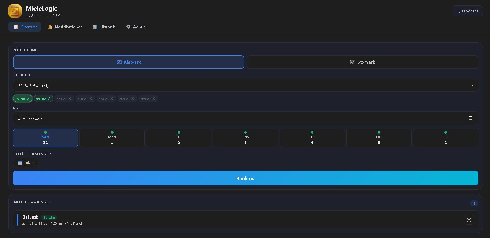
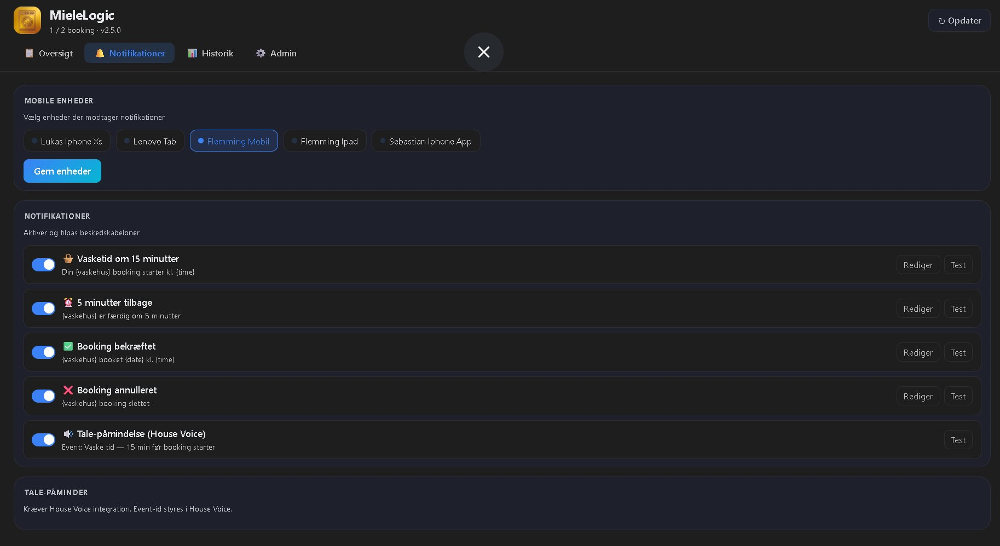
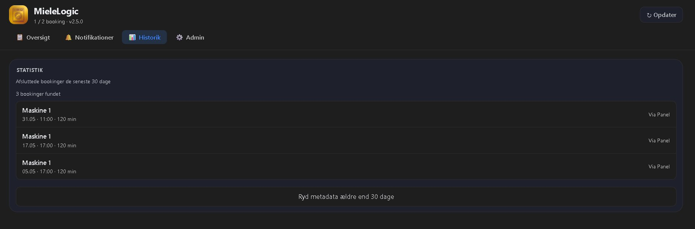
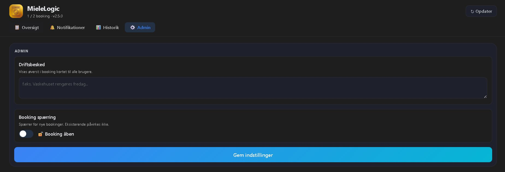
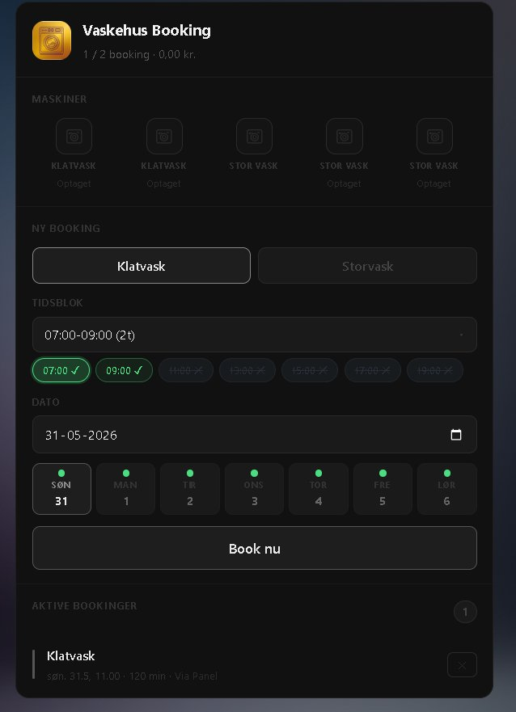

# MieleLogic — Home Assistant Integration

[](https://github.com/kingpainter/mielelogic/releases)
[](https://github.com/kingpainter/mielelogic/actions/workflows/validate.yml)
[](https://github.com/hacs/integration)
[](LICENSE.md)
[](https://www.home-assistant.io/)

Home Assistant integration for MieleLogic laundry room systems. Book washing slots, monitor machines in real time and receive notifications directly on your phone — all from Home Assistant.

> **Requirement:** Home Assistant Core 2026.1.0 or newer.

---

## What can it do?

**Booking** — Book Klatvask (wash) or Storvask (large wash) directly from a panel in the sidebar. Pick a date from a 7-day strip that shows which days have free slots. Time-slot chips show free/booked status in real time. Confirmation happens in an in-panel overlay — no native browser dialogs.

**Calendar sync** — Bookings are synced automatically to your primary calendar. When booking from the panel you can add the booking to one or more secondary calendars (e.g. a family member's calendar) via clickable chips in the booking form.

**Machine status** — See in real time whether machines are free, running, reserved or closed. Active bookings show a live countdown timer.

**Notifications** — Push messages on your phone when booking and as reminders. The booking notification contains a "Cancel booking" button — you can cancel directly from the notification without opening the app. Notification templates can be customised with variables.

**Admin** — Operational messages to all users and the option to temporarily block new bookings.

**Statistics** — View the last 30 days of completed bookings with user name and duration.

**Panel settings** — Sidebar title, icon, admin-only access and panel on/off can be changed via the Options Flow — without a restart.

---

## Screenshots

| Panel — Booking | Panel — Notifications |
|---|---|
|  |  |

| Panel — History | Panel — Admin |
|---|---|
|  |  |

| Mobile card |
|---|
|  |

---

## Installation

### Via HACS (recommended)

1. Open HACS → Integrations → Custom repositories
2. Add: `https://github.com/kingpainter/mielelogic`
3. Search for "MieleLogic" and install it
4. Restart Home Assistant

### Manual installation

1. Download the latest release from GitHub
2. Copy the folder `custom_components/mielelogic/` to your HA `config/custom_components/`
3. Restart Home Assistant

### Setup

1. Settings → Devices & services → Add integration → search for "MieleLogic"
2. Enter your MieleLogic login details
3. Configure machines, time slots and calendar
4. The panel appears automatically in the sidebar

---

## Configuration (Options Flow)

Settings → Devices & services → MieleLogic → Configure:

| Menu item | Description |
|---|---|
| **Credentials** | Update login details |
| **Calendar** | Primary calendar (auto-sync) + secondary calendars (optional per booking) |
| **Opening Hours** | Opening and closing times for the laundry room |
| **Machines** | Primary machine for Klatvask and Storvask |
| **Time Slots** | Add/delete time slots per laundry room |
| **Panel** | Sidebar title, icon, on/off, admin-only access |

All changes take effect immediately — no restart needed (except for Python files).

---

## Calendar integration

The **primary calendar** is configured in the Options Flow and synced automatically — both for bookings made on the MieleLogic portal and for bookings made through the panel.

**Secondary calendars** appear as chips in the booking form under "ADD TO CALENDAR". They are not selected by default — the user activates them per booking. Secondary events are deleted automatically when a booking is cancelled.

---

## Notifications

The booking notification contains:
- **"Cancel booking"** — destructive action button. Cancel directly from the notification on iOS and Android.
- **"Open panel"** — opens the MieleLogic panel directly.
- Sound and deep link on all notification types.

Notification templates support these variables: `{vaskehus}`, `{time}`, `{date}`, `{duration}`, `{machine}`.

---

## Design

The panel follows the **Indeklima Designer** design language:

- **Accent colours:** Blue `#3b82f6` / Cyan `#06b6d4`
- **Typography:** DM Sans (text) + DM Mono (numbers/code)
- **Layout:** Fixed top bar + scrollable content
- **Cards:** 18px border radius, subtle borders and hover effects
- **Responsive:** Tab labels hidden on mobile, reduced padding
- **Skeleton loading:** Shimmer-animated placeholder cards on initial load
- **In-panel toast:** Feedback shown as a slide-in toast (not disruptive HA persistent notifications)

---

## Version requirements

| Component | Minimum version |
|---|---|
| Home Assistant Core | **2026.1.0** |
| HA Companion App (notifications + cancel action) | Latest |
| Python | 3.11+ |

---

## File structure

```
custom_components/mielelogic/
├── __init__.py                    # Setup, runtime_data, notification action listener
├── manifest.json                  # dependencies: http, frontend, panel_custom
├── const.py                       # CONF_PRIMARY_CALENDAR, CONF_SECONDARY_CALENDARS
├── config_flow.py                 # Setup and options flow (6 options steps incl. primary/secondary calendar)
├── coordinator.py                 # API polling + primary calendar auto-sync
├── diagnostics.py
├── sensor.py                      # EntityDescription pattern
├── binary_sensor.py               # EntityDescription pattern
├── calendar.py
├── services.py                    # Services with response support
├── panel.py                       # Panel registration
├── time_manager.py
├── booking_manager.py             # make_booking(extra_calendars), secondary calendar sync
├── caldav_async.py                # Async CalDAV client (deletes events)
├── websocket.py                   # 18 WebSocket commands
├── storage.py                     # secondary_calendar_synced, booking metadata
├── notification_manager.py        # Deep link, sound, cancel action button
├── icons.json                     # Entity icons
├── strings.json
├── frontend/
│   ├── entrypoint.js              # Font preload (DM Sans/Mono)
│   ├── panel.js                   # Vanilla HTMLElement, shadow DOM
│   └── mielelogic-booking-card.js
└── translations/
    ├── da.json
    └── en.json
```

---

## WebSocket API (18 commands)

```
Booking:        get_slots · make_booking · cancel_booking · get_bookings · get_status · get_machines
Calendar:       get_calendars · get_week_availability
Notifications:  get_devices · save_devices · get_notifications · save_notification · test_notification · reset_notification
Admin:          get_admin · save_admin · get_history · cleanup_history
```

---

## Troubleshooting

**Panel does not appear**
Clear the browser cache (Ctrl+Shift+R). Check that the panel is enabled: Settings → Devices & services → MieleLogic → Configure → Panel.

**Notifications do not work**
Panel → Notifications → Check that devices are selected and notifications are enabled.

**Cancel from notification does not work**
Requires the latest HA Companion App. Check the HA log for `MIELELOGIC_CANCEL_` events.

**Calendar error at startup**
Requires Home Assistant 2026.1.0+.

**Secondary chips do not appear**
Configure secondary calendars under Settings → Devices & services → MieleLogic → Configure → Calendar.

---

## Known limitations

- Only one laundry room instance is supported (multi-laundry room planned for v3.0.0)
- The panel requires internet access for the DM Sans font (Google Fonts)

---

## Roadmap

See [CHANGELOG.md](CHANGELOG.md) for the full version history.

- **v2.5.4** ✅ — House Voice spoken reminder, storage migration, logo fix, CI fixes
- **v2.5.1** ✅ — Bug fix: `_renderWeekStrip` crash on booking cards, CI/CD workflow
- **v2.5.0** ✅ — Multi-calendar, runtime_data migration, secondary calendar tracking
- **v2.4.0** ✅ — Cancel from push notification, countdown timer, rich notifications
- **v2.3.0** ✅ — 7-day day strip with free/booked indicator
- **v2.2.0** ✅ — Inline booking/cancel confirmation, skeleton loading
- **v2.1.0** ✅ — Performance, in-panel toast, clickable chips, exponential backoff
- **v2.0.0** ✅ — Energy Hub panel registration, Indeklima Designer redesign
- **Next** — Gold tier tests, HACS/brands

---

## License

MIT — see [LICENSE.md](LICENSE.md)

---

**Latest version:** 2.6.6  
**Developer:** KingPainter
